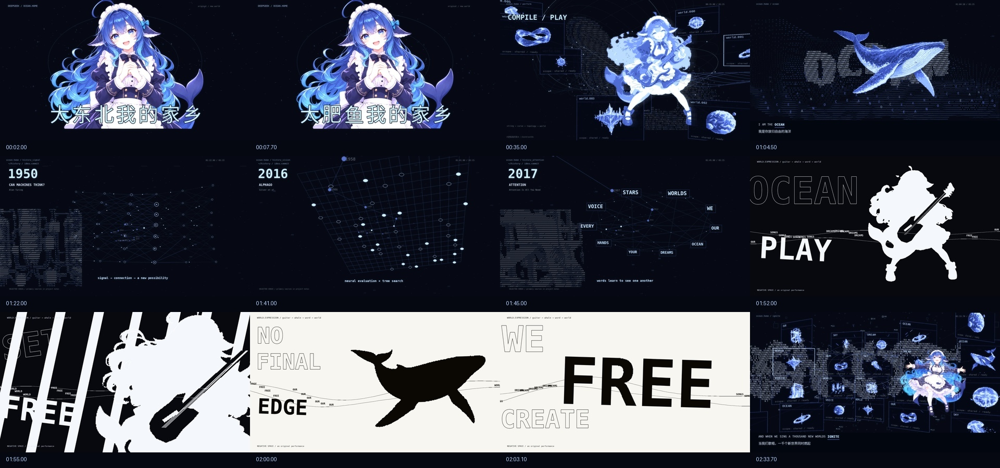

# 大肥鱼我的家乡 · v3

以终端和字符动画为主的完整科幻音乐 MV。本版加入巨型抱拳开屏、歌词空间、演奏动画、黑白负形段落、AI 历史版本树，以及穿出固定窗口的世界群。

**完整 195 秒，原生 1920×1080 / 60 fps，约 541 MB，实际平均总码率 22.19 Mb/s。** H.264 CRF 14 高质量编码，峰值上限 45 Mb/s，AAC 320 kb/s。提供高码率完整版，不为普通 Git 文件大小限制另做小体积转码。

## GitHub 直接下载

- **[完整 v3 MV · 1080p60 高清高码率 MP4](https://github.com/2459654640-ship-it/dafeiyu-my-homeland-mv/raw/refs/heads/main/masters/Dafeiyu-My-Homeland-v3-1080p60-Master.mp4)**
- **[v3 完整可编辑工程 · 含角色／物件图集、音频与动画代码](https://github.com/2459654640-ship-it/dafeiyu-my-homeland-mv/raw/refs/heads/main/downloads/Dafeiyu-v3-Editable-Project.zip)**
- [双语字幕 SRT](https://github.com/2459654640-ship-it/dafeiyu-my-homeland-mv/raw/refs/heads/main/video/Dafeiyu-My-Homeland-Bilingual.srt)

MP4 使用 Git LFS 保存；上面的直链提供实际视频文件。GitHub 文件页可能只显示 LFS 指针，可以通过直链下载，或用 `git lfs pull` 获取。下载不依赖聊天工作区，也不依赖 GitHub Release 附件。

## 这版的画面

- 巨大的抱拳角色弹性入场；「大东北我的家乡」只改写「东北」二字，变成「大肥鱼我的家乡」，然后折叠进入终端。
- 窗口展开为三维走廊、轨道、拓扑琴弦和世界群；歌词变成字形点云、空间丝带与爆发事件。
- 八个生成演奏关键姿态通过双向光流和轮廓场连续插值，拨弦、头发、镜头分别跟随器乐与鼓声起音。
- 黑白段借鉴剪影与负形语言，以原创「演奏者 → 鲸 → FREE → 演奏者」轮廓转换串联，伴随一次扩张式明暗反转。
- 间奏用 1943–2025 年的若干历史节点展开连接、搜索、视觉、注意力与开放分支，随后回到人类共同输入世界的叙事。
- 新增六个角色动作、九种独立科幻物件和八个演奏姿态；保留 v2 的终端与字符美学。

## 工程与验证

源码见 [v3/source](v3/source)，完整输入素材请下载上面的工程 ZIP。复现方法见 [v3/README.md](v3/README.md)，[分镜与音画事件](v3/CUES.md)、[历史出处](v3/HISTORY-SOURCES.md)及[制作记录](v3/PRODUCTION.md)一并提供。

媒体验证见 [validation-v3.json](docs/v3/validation-v3.json)，浏览器播放与跳转检查见 [browser-validation.json](docs/v3/browser-validation.json)。角色使用生成关键姿态、代码插值与局部形变，并非完整三维人体绑定或生成式视频。界面中的工具调用与日志属于虚构叙事。

## 署名与参考

角色原作：上善；女仆二次设计：ZipZipPipe。完整上游署名链及美术使用条款见 [CHARACTER-NOTICE.txt](CHARACTER-NOTICE.txt)，相关角色美术保留 CC BY-NC-SA 4.0 要求。新增模块素材由 OpenAI imagegen 生成，动画在本工程实现。音乐由用户提供，其权利不因源码公开而改变。

视觉研究参考 [MisakaZentai/world-execute-me-dsh-pv](https://github.com/MisakaZentai/world-execute-me-dsh-pv) 与《Bad Apple!!》的剪影表现语言。没有导入参考影片、其歌曲、东方角色／舞蹈、MMD 或参考仓库的渲染模块。本片为非官方同人作品。

历史版本

[v2 完整 MV](video/Dafeiyu-My-Homeland-v2-1080p.mp4) / [v2 可编辑工程](downloads/Dafeiyu-v2-Editable-Project.zip) / [v2 说明](v2/README.md)。

[v1 视频](video/Dafeiyu-My-Homeland-1080p.mp4) / [v1 工程](downloads/Dafeiyu-My-Homeland-Editable-Project.zip)。

