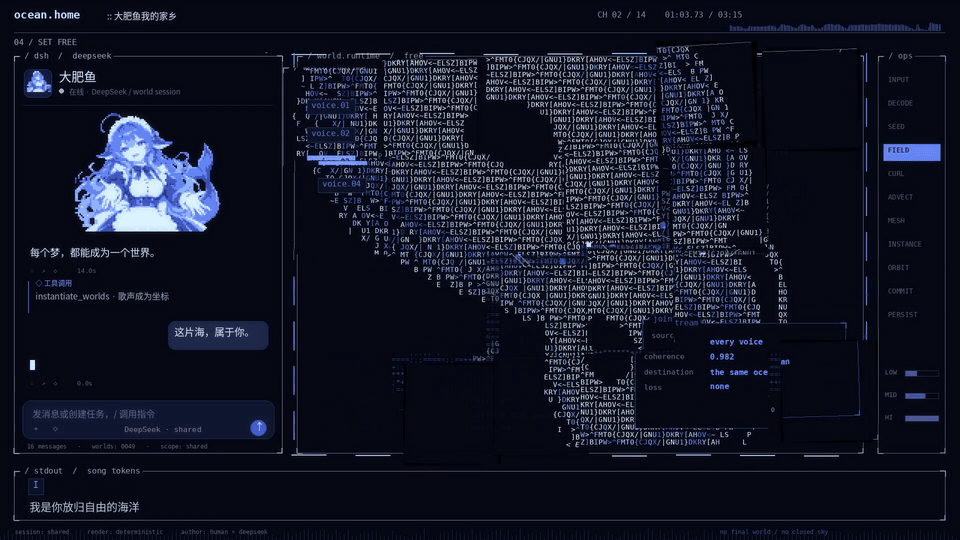

# 大肥鱼我的家乡 / v2

终端与字符特效为主的完整重做版：窗口、数据和角色元素持续变形、飞行和重组。完整 3 分 15 秒，1920×1080 / 30 fps，保留抱拳开场。

## 直接下载

- **[完整 v2 MV · 1080p](https://github.com/2459654640-ship-it/dafeiyu-my-homeland-mv/raw/refs/heads/main/video/Dafeiyu-My-Homeland-v2-1080p.mp4)**
- [v2 完整可编辑工程](https://github.com/2459654640-ship-it/dafeiyu-my-homeland-mv/raw/refs/heads/main/downloads/Dafeiyu-v2-Editable-Project.zip)
- [28 秒方向试片：开场 + 第一副歌](https://github.com/2459654640-ship-it/dafeiyu-my-homeland-mv/raw/refs/heads/main/video/Dafeiyu-v2-Motion-Proof.mp4)
- [双语字幕](video/Dafeiyu-My-Homeland-Bilingual.srt)

这是实际存放在本仓库中的 MP4 与 ZIP，直接通过 GitHub 下载，不依赖本地工作区或 Release 附件接口。

## 动态预览

预览对应早期方向试片；完整 v2 另含长间奏、递归窗口、三维终端镜头与末副歌，部分高潮的前后层次也已修正。

## 这一版重做了什么

- 44 个分镜段落、逐词动画标签与随编曲变化的终端布局和图形。
- 四个生成角色姿态，配合眨眼、肩腕局部控制、发尾像素网格和角色状态动画。
- 可变形的鲸、岛屿、行星、轨道城市与晶体等模块化 AI 素材，不使用完整背景插画推拉作为主要画面。
- 字符潮汐、数值积分轨迹、三维图像浮雕、递归几何、卫星窗口、运动流线与数据包。
- 窗口碎片、折叠转场、局部显存行错位、点击反馈、节拍冲击与三维终端镜头。

代码在 [v2/source](v2/source)。完整输入资产与音频特征在 v2 工程 ZIP 中，复现说明见 [v2/README.md](v2/README.md)。角色属于生成关键姿态与代码动画，并非完整三维人体骨骼演出。技术验证不等于艺术效果或传播表现的保证。

## 署名与参考

角色原作：上善（鲸鱼娘）；女仆二次设计：ZipZipPipe。用户提供角色参考，本片角色图集和模块化物件由 AI 生成，动画与程序渲染在本项目实现。相关角色美术保留上游 CC BY-NC-SA 4.0 的署名、非商业及相同方式共享要求，见 [CHARACTER-NOTICE.txt](CHARACTER-NOTICE.txt)。音乐由用户提供，其权利不因源码公开而改变。

视觉研究参考 MisakaZentai 的 [world-execute-me-dsh-pv](https://github.com/MisakaZentai/world-execute-me-dsh-pv)，研究了公开参考成片与出片思路；没有将参考影片、其歌曲、MMD 或渲染模块混入本片。本片为含 AI 素材与程序渲染的非官方同人作品。

历史版本 v1（已由 v2 重做）

[旧 v1 视频](video/Dafeiyu-My-Homeland-1080p.mp4) / [旧 v1 工程](downloads/Dafeiyu-My-Homeland-Editable-Project.zip)。根目录 source/ 与 docs/ 中部分文档属于 v1 记录，请优先阅读 v2/。

